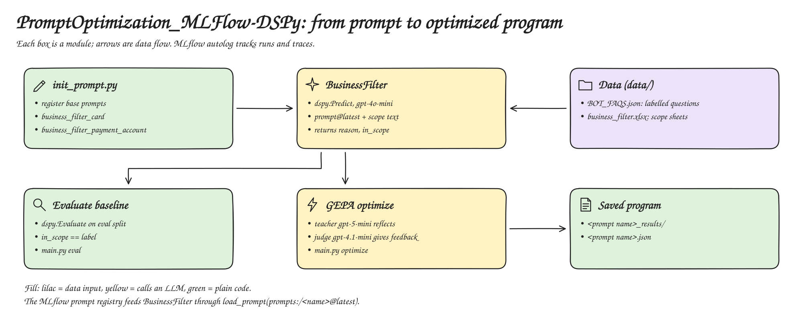

<div align="center">

# PromptOptimization_MLFlow-DSPy

**Prompt versioning and optimization with MLflow and DSPy, shown on a business scope classifier.**


[Overview](#overview) · [Architecture](#architecture) · [Quickstart](#quickstart) · [Configuration](#configuration) · [Licenses](#licenses)

</div>

## Overview

A pipeline for prompt engineering, versioning and automated optimization, using the MLflow prompt registry and DSPy. The use case is a **business filter**: it decides whether a user question (Vietnamese text) falls inside a predefined business scope.

| At a glance | |
|---|---|
| Commands | 3 (`init`, `eval`, `optimize`) in `main.py` |
| Models | 3 roles: student `gpt-4o-mini`, teacher `gpt-5-mini`, judge `gpt-4.1-mini` |
| Prompts registered | 2 (`business_filter_card`, `business_filter_payment_account`) |
| Optimizer | DSPy `GEPA`, scored by exact match on `in_scope` plus LLM-written feedback |

## Architecture

<p align="center"></p>

`init` registers the base prompts. `eval` and `optimize` both load `prompts:/<name>@latest` from MLflow, build the `BusinessFilter` program, then score it on the eval split or optimize it with GEPA.

```
.
├── main.py                       # CLI: init | eval | optimize
├── config.py                     # CONFIG dict and MLflow setup
├── init_prompt.py                # register base prompts to MLflow
├── optimization.py               # BusinessFilter program, baseline eval, GEPA
├── dataloaders/
│   └── business_filter.py        # dataset split and scope text from Excel
├── evaluations/
│   └── business_filter.py        # exact-match metric and feedback metric
├── docs/diagrams/                # README figure and the script that draws it
└── data/                         # not tracked: BOT_FAQS.json, business_filter.xlsx
```

<details>
<summary>Tech stack</summary>

| Layer | Tool |
|---|---|
| Prompt registry, experiment tracking | MLflow (`mlflow.genai`, `mlflow.dspy.autolog`) |
| Programs and optimizer | DSPy (`Predict`, `Evaluate`, `GEPA`) |
| LLM provider | OpenAI via DSPy |
| Data | pandas, openpyxl |
| Config | python-dotenv |

</details>

## Quickstart

Prerequisites: Python 3, an OpenAI API key, a reachable MLflow server (`mlflow server --host 127.0.0.1 --port 5000`), and the two data files below.

```bash
pip install -r requirements.txt
echo "OPENAI_API_KEY=your_key" > .env
python main.py init && python main.py eval
```

`python main.py optimize` runs GEPA and saves the program to `<prompt name>_results/<prompt name>.json`.

<details>
<summary>Data files (not tracked, `data/` is in `.gitignore`)</summary>

- `data/BOT_FAQS.json`: a list of items with `Category`, `Question` and `Scope` (`"in scope"` for positives). Items are filtered by `CONFIG["CATEGORY"]`, shuffled with seed 0, and the last `EVAL_SAMPLE_RATE` (10%) becomes the eval split.
- `data/business_filter.xlsx`: one sheet per business, named by the lowercased category (for example `paymentaccount`), with columns `category`, `intent`, `detail`, `scope`. `Inscope` and `Ủy quyền` rows become the in-scope text, `Outscope` and `Không ủy quyền` rows the out-of-scope text, other rows are dropped.

</details>

<details>
<summary>Use it as a library</summary>

```python
from config import setup_and_configure
from optimization import build_business_filter

setup_and_configure()
business_filter = build_business_filter()  # loads prompts:/<name>@latest
result = business_filter(question="Tôi muốn đổi mật khẩu iPay")
print(result.in_scope, result.reason)
```

</details>

## Configuration

Everything lives in the `CONFIG` dict in `config.py`. Environment variables: `OPENAI_API_KEY` (required), `MLFLOW_TRACKING_URI` (default `http://127.0.0.1:5000`).

| Key | Default |
|---|---|
| `MODEL_CONFIG` (student) | `openai/gpt-4o-mini`, temperature 0, 16000 max tokens |
| `TEACHER_MODEL_CONFIG` (GEPA reflection) | `openai/gpt-5-mini`, temperature 1, 64000 max tokens |
| `JUDGE_MODEL_CONFIG` (feedback and evaluation) | `openai/gpt-4.1-mini`, temperature 0, 32000 max tokens |
| `CATEGORY`, `PROMPT_NAME` | `PaymentAccount`, `business_filter_payment_account` |
| `EVAL_SAMPLE_RATE` | `0.1` |
| `EXPERIMENT_NAME` | `Business_Filter_Optimization` |

## Contributing

Adding a new business filter:

1. Add the prompt to `PROMPTS` in `init_prompt.py` and run `python main.py init`.
2. Add a sheet to `data/business_filter.xlsx` and items to `data/BOT_FAQS.json`.
3. Set `CATEGORY` and `PROMPT_NAME` in `config.py`.

To redraw the architecture figure: `python docs/diagrams/make_diagrams.py` (Python 3.10+, standard library only).

## Licenses

<details>
<summary>Third-party</summary>

- Figure font: Patrick Hand, SIL OFL 1.1, see [`docs/diagrams/OFL.txt`](docs/diagrams/OFL.txt).
- Models are called through the OpenAI API and are subject to OpenAI's terms.

</details>

Code: the repository has no license file yet.

Related docs: [MLflow prompt engineering](https://mlflow.org/docs/latest/llms/prompt-engineering/index.html) · [DSPy documentation](https://dspy.ai/)
